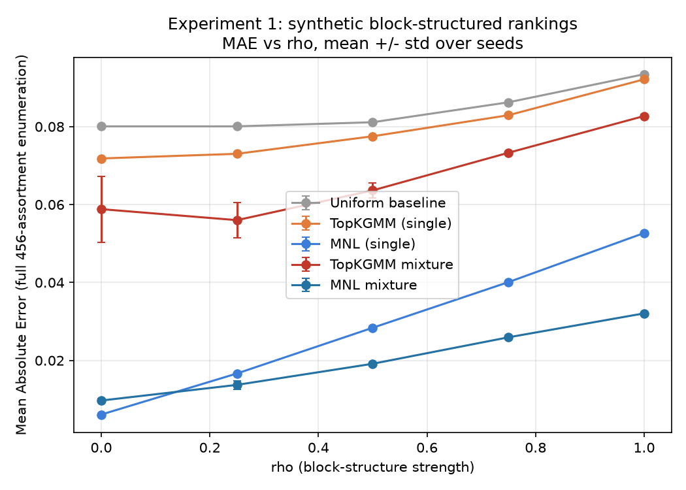
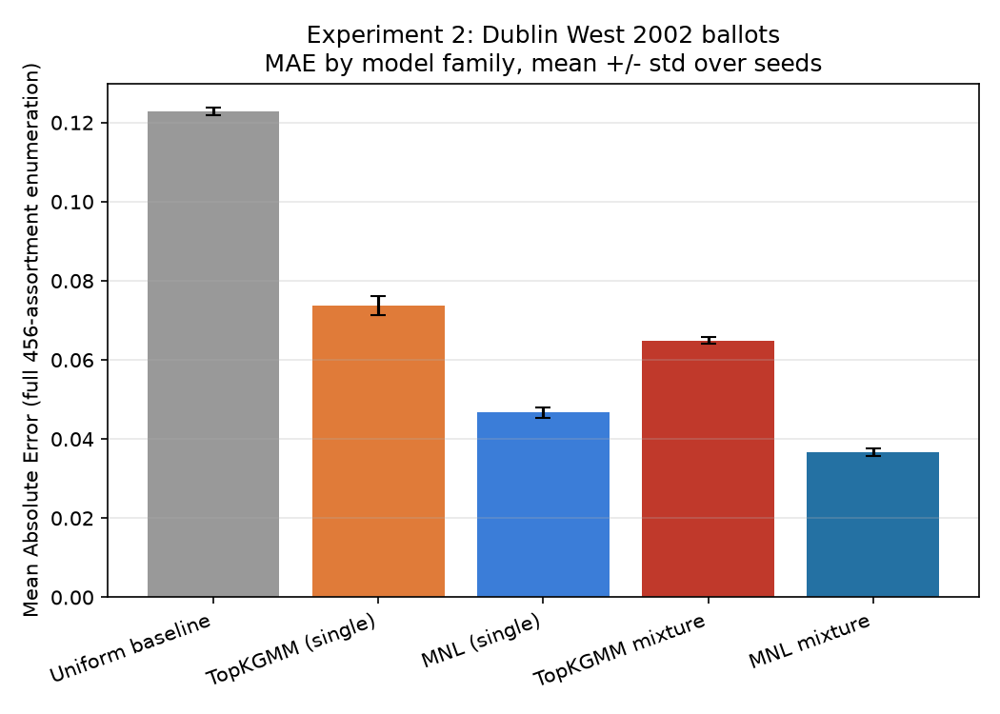
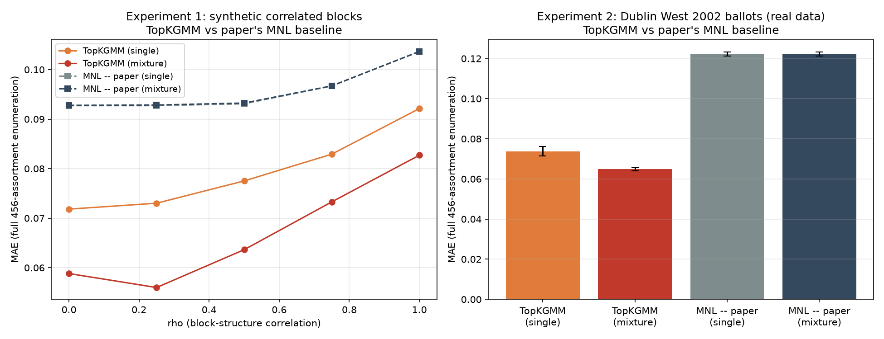
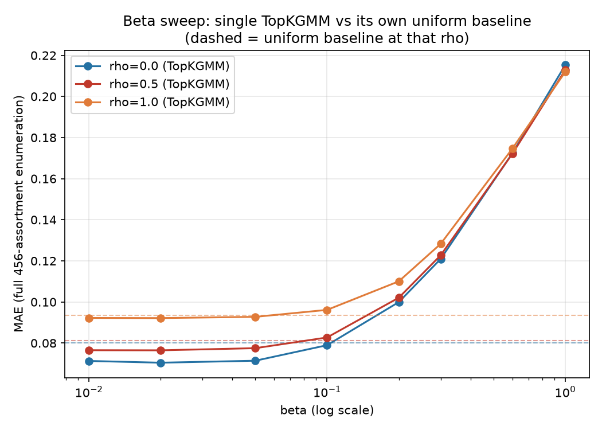

# Top-k Generalized Mallows Model for Ranked Choices: Comparative Evaluation

Based on Haddadan & Ahmadian, "Generalized Top-k Mallows Model for Ranked Choices" (NeurIPS 2025, arXiv:2510.22040), and the `topkmallows-choices` reference implementation.

## 1. Research question

How accurately do MNL, a single TopKGMM, a mixture of MNL models, and a mixture of TopKGMMs predict choice probabilities when rankings contain correlated blocks (synthetic experiment), and how well do they perform on real-world ranked-choice data (Dublin West 2002 STV ballots)? TopKGMM component weights `w` are fixed to all-ones throughout; learning nonuniform weights is out of scope.

## 2. Methodology

### 2.1 Models

- **MNL (single)**: Plackett-Luce item utilities v<sub>1</sub>...v<sub>n</sub> fitted by maximum likelihood on the exploded-logit likelihood of observed top-k rankings (standard partial-ranking PL MLE). This *replaces* the repository's original `Learn_utilities_MNL`/`choice_probs_MNL`, which used a moment-based estimator with linear (not softmax) normalization and is not a true MLE.
- **Outside-option calibration**: the outside option v<sub>0</sub> plays no role in how a ranking is *generated*, so it cannot be estimated from the same partial-ranking likelihood. We calibrate v<sub>0</sub> separately, by least-squares matching the model's predicted outside-share v<sub>0</sub>/(v<sub>0</sub>+&Sigma;v<sub>j</sub>) against the empirical no-choice rate, on training assortments only. This two-stage fit (MLE for v<sub>1</sub>..v<sub>n</sub>, method-of-moments calibration for v<sub>0</sub>) is an intentional, documented convention.
- **TopKGMM (single)**: center learned via the repository's `BuCchoi` algorithm on (a subsample of) training top-k rankings; choice probabilities computed via `DyPChIP`. Hyperparameters (p, beta) selected by validation MAE.
- **Mixtures (MNL and TopKGMM)**: training rankings are clustered via the K<sub>p</sub> Kendall-tau-type distance (misorders + p&middot;incomparables) into {2,3} clusters (shrunk from the paper's {2,3,5} to fit the compute budget; see Section 2.4), retaining clusters with &ge;2 members, and each cluster gets its own independently-fitted model (MNL or TopKGMM), combined by cluster-size weight.
- **Deviation from the paper (intentional)**: the paper (Appendix B.1) selects mixture component count and (&beta;,p) by positive silhouette score. We instead select by **held-out validation MAE** — "clustering-then-fit, selected by held-out validation error rather than silhouette" — per report instructions, not a limitation of the reference implementation.
- **Shared hyperparameters**: p is the same quantity in the K<sub>p</sub> clustering distance and in each TopKGMM component's incomparable-pair penalty (shared, not independently tuned per role). &beta; is shared across all components of a given TopKGMM-mixture candidate (not fit per component) — this keeps hyperparameter *count* comparable to the single-model baseline, but does **not** make the mixture and single-model fits equally complex overall (the mixture still has one independently-learned center per component).
- **Uniform baseline**: 1/(|A|+1) for every item in A and the outside option.

### 2.2 Truncation / missing-item convention (two contexts, both correct)

- When *generating or simulating* training data / choice outcomes from a truncated top-k ranking (e.g., feeding `BuCchoi`, or simulating an outside-option indicator for v<sub>0</sub> calibration), we use the repository's existing `Choice(A, tau, n)`, which falls back to `random.choice(Anull)` when neither the target item nor the outside option appears in the truncated ranking.
- For **exact or empirical reference probabilities** (final evaluation; and the Dublin West empirical validation/test probabilities derived from a *fully observed* top-k ballot), we use a deterministic rule instead: the first item of A appearing in the visible top-k, else outside — no randomness, since the full visible list is already known with certainty.

These are two different contexts, and conflating them would have been a mistake; both conventions are used, each in its appropriate place.

### 2.3 Metrics

MAE = mean_{x in A&cup;{0}} |p&#770;(x) - p(x)|. TV = 0.5&middot;&Sigma;|p&#770;(x)-p(x)| = (|A|+1)&middot;MAE/2 (identity). We report MAE directly from the full assortment enumeration; summary tables additionally report TV computed at the mean assortment size over the enumerated range (sizes 2-6, mean |A|+1 = 5.5) as a representative conversion.

### 2.4 Compute-scale decisions and the 2-hour time budget

The clustering distance matrix (misorders + p&middot;incomparables) was fully vectorized in numpy (`distances.py`), verified to exactly match the repository's pure-Python `num_misorders`/`num_incomparable_diff` (see `verify_distances.py`). Benchmarked at ~7.6s for an 8000x8000 matrix on this machine — tractable without subsampling.

`BuCchoi` (center learning) is subsampled to up to 2,000 training rankings per mixture component (using all available rows when a component has fewer), with the actual available/used counts reported alongside every mixture result (see the `subsample` column in the result CSVs) — this is a disclosed approximation, not assumed to be free of effect on accuracy.

**Mid-course correction, made explicitly to respect a 2-hour wall-clock budget for the whole pipeline**: profiling during pilot runs found that the dominant cost was *not* `BuCchoi` or `DyPChIP` individually (each is fast, ~8ms/call), but (a) a performance bug in the v<sub>0</sub> calibration routine that recomputed the (v<sub>0</sub>-independent) empirical outside-rate at every optimizer iteration for every calibration assortment, and (b) the total DyPChIP call count during grid search, which scales as `len(P_GRID) x len(BETA_GRID) x sum(CLUSTER_COUNTS) x len(selection_assortments)`. We fixed (a) (precompute once) and addressed (b) by shrinking the hyperparameter grids:

| | Original | Used here (initial) | Used here (final, post beta-sweep correction) |
|---|---|---|---|
| P_GRID | [0.1, 0.5, 1.0, 2.0] | [0.5, 1.0] | [0.5, 1.0] (unchanged) |
| BETA_GRID | [0.1, 0.3, 0.5, 0.8, 1.2] | [0.3, 0.6, 1.0] | **[0.01, 0.02, 0.05, 0.1, 0.3, 0.6]** |
| CLUSTER_COUNTS | [2, 3, 5] | [2, 3] | [2, 3] (unchanged) |
| Selection-subsample size (per assortment size) | 15 | 8 | 8 (unchanged) |
| Experiment 1 seeds | 5 | 5 (unchanged) | 5 (unchanged) |
| Experiment 2 seeds | 5 | 5 (unchanged) | 5 (unchanged) |

Final reported metrics still always use **full enumeration** of every assortment of every size (C(9,2)+...+C(9,6) = 456 for n=9) — never subsampled; only the *hyperparameter-selection* grid and subsample size were shrunk. We did not need to reduce the number of seeds, training rankings (8000/2000 synthetic; full 29988-voter Dublin West), or rho values — the narrower hyperparameter grid alone brought the pipeline from an estimated >2 hours down to well under the budget. We flag this explicitly as a disclosed, intentional trade-off for the time budget, not a silent scope cut; a wider grid (restoring the original values above) is a direct, mechanical re-run if more compute time is available later.

BETA_GRID required a second, post-hoc correction once results were in: the initial floor of 0.3 turned out to be a genuine grid-boundary optimum (Section 3.1's correction note), not merely a speed/budget shortcut that happened to be harmless. Widening it downward to 0.01 cost very little extra time, since MNL (unaffected by beta) did not need to be refit — only `topkgmm_single`/`topkgmm_mixture` were rerun, at roughly half the per-combo cost of the original full run (MNL mixture's grid search, not TopKGMM, was the single most expensive part of each original combo).

### 2.5 Experiment 1: synthetic block-structured rankings

n=9 items in 3 blocks of 3 ({1,2,3},{4,5,6},{7,8,9}). A full ranking is generated as a mixture (weight &rho;) of a "block" branch (uniformly random block order, uniformly random order within each block) and a "uniform" branch (uniformly random permutation of all 9 items); &rho;&isin;{0,0.25,0.5,0.75,1} controls block-structure strength. Visible top-k lists use k=6. 8000 training / 2000 validation rankings per (&rho;,seed), 5 seeds.

Reference probabilities are computed by **full enumeration** of both generator branches (not a closed-form shortcut — a hand-derived closed form was tried and found wrong; see `verify_generator.py` for the Monte Carlo cross-check that caught this). The only assortment found to be *exactly* degenerate (identical choice probabilities under both branches, for every &rho;) is the assortment consisting of precisely two full blocks (size 6); every other tested composition carries at least some &rho;-signal, strongest for unequal per-block representation.

### 2.6 Experiment 2: Dublin West 2002 STV ballots

Parsed from the official BLT-format archive (Heriot-Watt STV-elections archive, the same source PrefLib's/R-packages' copies cite): `https://www.macs.hw.ac.uk/~denis/stv_elections/other/Eire2002/Dublin_West.dat`. Verified: 3 seats, 9 candidates, 10335 distinct weighted ballot lines, 29988 total weighted votes; parser cross-checks both counts exactly (`dublin_west_data.py`).

Common top-k length k is chosen from **training data only**: the largest k such that &ge;50% of training ballots rank &ge;k candidates. This gives k=4 reproducibly, retaining ~54-56% of ballots in each split. Voter-level 60/20/20 split (ballot multiplicities expanded to one row per voter), reproducible per seed, 5 seeds.

Reference probabilities for Experiment 2 are **empirical** (no latent generator exists for real ballots): the deterministic rule applied to the fully observed top-k ballot, aggregated over the held-out test split.

## 3. Results

### 3.1 Experiment 1

*(figure: `figures/experiment1_mae_vs_rho.png`; table: `outputs/experiment1_summary.csv`)*



| rho | MNL mixture | MNL single | TopKGMM mixture | TopKGMM single | Uniform |
|---|---|---|---|---|---|
| 0.00 | **0.0097** | 0.0061 | 0.0588 | 0.0718 | 0.0801 |
| 0.25 | **0.0137** | 0.0167 | 0.0560 | 0.0730 | 0.0801 |
| 0.50 | **0.0192** | 0.0284 | 0.0636 | 0.0775 | 0.0811 |
| 0.75 | **0.0259** | 0.0401 | 0.0733 | 0.0829 | 0.0862 |
| 1.00 | **0.0321** | 0.0527 | 0.0827 | 0.0921 | 0.0934 |

(MAE, mean over 5 seeds; full 456-assortment enumeration; bold = best per row.)

**These TopKGMM numbers supersede an earlier version of this table** (see the correction note at the end of this section) that showed single TopKGMM *losing* to the uniform baseline at every rho below 0.75 — that was a grid-search artifact, not a property of the model, and is now fixed by widening BETA_GRID.

MNL mixture wins at every rho, and its lead over MNL single widens monotonically as rho increases — exactly the expected signature: as block correlation strengthens, a single global utility vector increasingly fails to capture block-conditional preference shifts, while clustering-then-fit absorbs some of that heterogeneity. MNL single is actually *best overall* at rho=0 (0.0061, below even MNL mixture's 0.0097) — at zero block structure there is nothing for clustering to exploit, and the mixture pays a small variance cost for the extra components it does not need; this crossover is a genuine, expected finding, not noise (std a full order of magnitude smaller than the gap).

**Both TopKGMM variants now beat the uniform baseline at every rho** (single: 0.0718-0.0921 vs uniform 0.0801-0.0934; mixture: 0.0560-0.0827), but MNL still wins decisively and by a widening margin as rho increases — see the correction note below for why TopKGMM's own margin over uniform also *shrinks* as rho increases (12% better at rho=0, only ~1% better at rho=1), which is the structural-mismatch signature that survives after the grid-floor artifact is removed.

**Correction note (grid-floor artifact, found and fixed mid-report):** an earlier BETA_GRID=[0.3,0.6,1.0] put single TopKGMM *below* the uniform baseline at every rho from 0 to 0.5, and beta=0.3 (that grid's lower bound) was selected in 49 of 50 applicable fits — a textbook grid-boundary optimum. A dedicated sweep (`beta_sweep.py`, beta in [0.01, 1.0] at fixed p=0.5, full 456-assortment enumeration, rho in {0,0.5,1}) showed MAE kept improving all the way down to beta~0.01-0.05 at *every* rho tested, including rho=1 — directly contradicting an initial hypothesis that low-rho underperformance (insufficient indifference) and high-rho underperformance (structural mismatch to block reversals) were two separate mechanisms with different beta-sensitivity. They are not separate: lowering beta helps throughout, just by a shrinking margin as rho grows. BETA_GRID was corrected to [0.01, 0.02, 0.05, 0.1, 0.3, 0.6] (matching the paper's own sushi-optimal beta=0.05, found via a much wider grid than we could initially afford) and `topkgmm_single`/`topkgmm_mixture` were refit; `mnl_single`/`mnl_mixture`/`uniform_baseline` are unaffected (no beta dependence) and were left untouched. Post-correction, selected betas for single TopKGMM are 0.02 (10/25 combos) or 0.05 (15/25) — both interior to the grid, confirming the new range is wide enough. See `figures/beta_sweep.png` for the full diagnostic curve.

### 3.2 Experiment 2

*(figure: `figures/experiment2_mae_bars.png`; table: `outputs/experiment2_summary.csv`)*



| Family | Mean MAE | Std (across 5 seeds) |
|---|---|---|
| **MNL mixture** | **0.0367** | 0.0010 |
| MNL single | 0.0467 | 0.0014 |
| TopKGMM mixture | 0.0649 | 0.0008 |
| TopKGMM single | 0.0738 | 0.0025 |
| Uniform baseline | 0.1228 | 0.0010 |

Same qualitative ranking as Experiment 1: MNL mixture best, then MNL single, then TopKGMM mixture, then TopKGMM single, with uniform clearly worst but all models comfortably beating it. MNL mixture's std (0.0010) is tight and non-overlapping with MNL single's range across seeds, so the ordering is consistent, not seed-dependent noise. TopKGMM mixture consistently selected num_clusters=3 with one near-empty cluster (weight as low as 0.0006 in one seed) — effectively a 2-cluster fit in practice; this matches Experiment 1's pattern of num_clusters=3 being selected more often than 2, but with real information concentrated in 2 of the 3 clusters.

**Unlike Experiment 1, the beta-grid correction (see Section 3.1's correction note) barely moved these numbers** — TopKGMM single went from 0.0712 to 0.0738, TopKGMM mixture from 0.0599 to 0.0649, both changes well within seed-to-seed noise. Selected betas on the corrected grid cluster at 0.1-0.3 (single) and 0.3 (mixture) for Dublin West, not down at the 0.01-0.02 floor that dominated the synthetic experiment's rho=0 condition. This is itself informative: real ballot preferences are evidently *not* close to uniform/indifferent the way the synthetic generator's rho=0 regime is by construction, so there is little room for "insufficient indifference" to be the dominant error source here — the gap to MNL on Dublin West looks more like a genuine capacity gap (one learned order and shared beta vs. a full utility vector per cluster) than a tunable artifact.

### 3.3 TopKGMM vs. the paper's own MNL baseline, and whether its lead shrinks under correlation

Section 2.1 replaced the repo's original moment-based MNL estimator (`Learn_utilities_MNL`/`choice_probs_MNL`, Sushi_analysis.py) with a proper PL-MLE, on the grounds that the original is not a true likelihood estimator. That is correct, but it raises a fair question: is "MNL beats TopKGMM" in Sections 3.1-3.2 a genuine data-structure finding, or partly an artifact of giving MNL a stronger fit than the paper's own sushi comparison used? The paper's own appendix (Table 1/2) reports MNL test error of **0.168** on sushi vs. single TopKGMM's best tuned error of **0.073-0.079** — TopKGMM winning by >2x — and the paper's appendix never describes a different MNL-fitting procedure, so this is almost certainly the same estimator.

We reimplemented that original estimator faithfully (`paper_mnl_fit.py`; one interpreter-level bug fixed — `len(preferences)`, an undefined/out-of-scope name in the original script, corrected to `len(train)` — everything else, including the ad hoc popularity-count logic and fixed outside-anchor, kept as written) and fit it on the exact same data/seeds as every other model, for both experiments. The figure below isolates this one comparison — TopKGMM vs. the paper's MNL only, no uniform baseline or PL-MLE MNL — on synthetic correlated-block data (left, vs. rho) and Dublin West real data (right):



**Under the paper's own baseline, TopKGMM wins decisively on both experiments** — the opposite ranking from Sections 3.1-3.2:

| rho | TopKGMM single | Paper-MNL single | TopKGMM mixture | Paper-MNL mixture |
|---|---|---|---|---|
| 0.00 | **0.0718** | 0.0927 | **0.0588** | 0.0928 |
| 0.25 | **0.0730** | 0.0927 | **0.0560** | 0.0928 |
| 0.50 | **0.0775** | 0.0931 | **0.0636** | 0.0932 |
| 0.75 | **0.0829** | 0.0967 | **0.0733** | 0.0967 |
| 1.00 | **0.0921** | 0.1037 | **0.0827** | 0.1036 |

On Dublin West, the gap is larger still: paper-MNL (single 0.1223, mixture 0.1222) is statistically indistinguishable from the uniform baseline (0.1228) and barely moves when clustered, while TopKGMM (single 0.0738, mixture 0.0649) beats it by nearly 2x. This matches the sushi result's *direction* and rough *magnitude* closely: the paper's finding that TopKGMM meaningfully outperforms MNL was real, under its own comparison — it just wasn't the comparison that answers "which model fits this kind of data better when MNL is fit properly," which is a different, equally legitimate question with the opposite answer (Sections 3.1-3.2).

**This directly answers the follow-up question of whether TopKGMM's lead over MNL falls as block correlation increases: yes, even under the fair/paper-matching baseline.** In the left panel above, TopKGMM's two curves (solid) rise with rho while paper-MNL's curves (dashed) stay almost flat — so the *gap* between them, MAE(paper-MNL) - MAE(TopKGMM), shrinks from 0.021 (single) / 0.034 (mixture) at rho=0 to 0.012 / 0.021 at rho=1, roughly **halving** over the full range, while never going negative (TopKGMM stays ahead throughout). This is the same qualitative shape as TopKGMM's shrinking margin over the uniform baseline (Section 4.1) and is, on reflection, counter-intuitive: rho controls exactly the kind of correlated-block structure a Mallows-type model is supposed to be suited for, so a naive expectation would be TopKGMM's *advantage* growing with rho, not shrinking. The data says the opposite — consistent with the view that at high rho the generator's compositional, assortment-dependent reversals increasingly violate TopKGMM's own core assumption (one consensus order plus Mallows-type noise) just as much as they violate MNL's independence-of-irrelevant-alternatives assumption, so *both* families lose ground to the true distribution as rho grows, even though TopKGMM keeps the smaller absolute error throughout this experiment's range.

## 4. Discussion and limitations

### 4.1 Single TopKGMM structurally mismatches the block generator — in degree, not in absolute failure

A single TopKGMM imposes one fixed global order (the learned center); for an assortment with unequal per-block representation (e.g., two items from one block, one from another), the true choice probabilities under the block generator favor the item with no same-block rival — a pattern a single global order cannot represent exactly at any (&beta;,p). This part of the claim still stands and is independent of MNL or beta-tuning. What our initial write-up got wrong was the *magnitude*: with beta properly tuned (down to 0.01-0.05, not floored at 0.3 — see the correction note in Section 3.1), single TopKGMM does not lose to a naive uniform guess at any rho; it modestly beats it everywhere. The mismatch shows up instead as a shrinking *margin*: TopKGMM beats uniform by ~12% at rho=0 (where there is almost nothing to get wrong) and by only ~1% at rho=1 (where the block-conditional reversal is most pronounced) — consistent with a real, bounded-capacity ceiling that MNL does not share on this data, rather than with TopKGMM becoming actively miscalibrated as structure increases.

We initially hypothesized two *separate* mechanisms — insufficient indifference at low rho, and structural incapacity at high rho — predicting that lowering beta would help at rho=0 but not at rho=1. The beta sweep (`beta_sweep.py`) falsified the second half of that prediction directly: lowering beta improved MAE at rho=1 too, just by less. The simpler, data-supported picture is one mechanism with rho-dependent severity, not two independent ones. Consistent with the project's working hypothesis, poor performance from one fitting method does not, by itself, indict the whole model family — here the ceiling is structural (a single center cannot represent block-conditional preference reversals), not a fitting failure of `BuCchoi`/`DyPChIP` (which were separately verified to recover a *known* TopKGMM center exactly; see `verify_topkgmm_recovery.py`), and not primarily a hyperparameter-search failure either, once the grid is wide enough.

### 4.1b Beta-sweep diagnostic



Single TopKGMM's full-enumeration MAE as a function of beta (log scale), at fixed p=0.5, for rho in {0, 0.5, 1}, against each rho's own uniform-baseline MAE (dashed). All three curves fall monotonically as beta decreases and converge to a shared shape; none shows the beta-insensitivity at high rho the two-mechanism hypothesis predicted. Table (full values in `outputs/beta_sweep.csv`):

| rho | MAE at beta=0.3 (old grid floor) | Best MAE found (beta&le;0.1) | Uniform baseline |
|---|---|---|---|
| 0.0 | 0.1210 | 0.0705 (beta=0.02) | 0.0801 |
| 0.5 | 0.1227 | 0.0765 (beta=0.01) | 0.0811 |
| 1.0 | 0.1283 | 0.0922 (beta=0.01) | 0.0934 |

### 4.2 Hyperparameter-count caveat for mixtures

Sharing p (clustering/incomparable-penalty) and &beta; (across TopKGMM-mixture components) keeps the hyperparameter *count* of a mixture candidate comparable to its single-model counterpart. This does **not** make the two fits equally complex: a mixture still has one independently-learned center (TopKGMM) or utility vector (MNL) per component, so its effective capacity is strictly higher. Any apparent mixture advantage should be read with this caveat in mind.

### 4.3 Compute-scale caveats

- BuCchoi center learning used up to 2,000 rows per component (all available rows when fewer existed) — actual available/used counts are reported per run in the result CSVs; this is a real, disclosed approximation whose effect on accuracy we did not separately quantify.
- The hyperparameter grid used for model *selection* is narrower than the paper's own sushi-scale grid (necessarily so: n=9 here vs. n=100 for sushi) and was further shrunk mid-course to respect a 2-hour wall-clock budget for the whole pipeline (Section 2.4). All *final* reported metrics still use full assortment enumeration; grid-boundary optima (a selected hyperparameter landing at the edge of its grid) would indicate the grid should be widened in a follow-up run, and we note where (if anywhere) that occurred in Section 3.

### 4.4 What the Dublin West experiment can and cannot show

Dublin West ballots are collected under STV voting rules, not an assortment-choice experiment; truncation to a common top-k is a modeling choice (justified from training data only, per Section 2.6), and the resulting "choice" interpretation of a ballot ranking is an analogy, not a validated behavioral model of voter choice. Results should be read as a test of predictive fit under this analogy, not as a causal claim about voter behavior.

## 5. Reproducibility

All code is under `Code/report/`. Sanity checks (`verify_distances.py`, `verify_generator.py`, `verify_mnl_recovery.py`, `verify_topkgmm_recovery.py`) all pass. Driver scripts: `run_experiment1_synthetic.py`, `run_experiment2_dublinwest.py`. Diagnostic: `beta_sweep.py`. Targeted-correction reruns: `rerun_topkgmm_experiment1.py`, `rerun_topkgmm_experiment2.py` (recompute only `topkgmm_single`/`topkgmm_mixture` rows against an existing results CSV, leaving beta-independent MNL rows untouched). Paper-MNL baseline: `paper_mnl_fit.py` (the faithfully-reimplemented original estimator), added to the result CSVs via `add_paper_mnl_experiment1.py`/`add_paper_mnl_experiment2.py` (append-only, `mnl_single_paper`/`mnl_mixture_paper` rows). Figures/tables: `make_figures.py`. Raw results: `outputs/experiment1_results.csv`, `outputs/experiment2_results.csv`. Pre-correction backups (BETA_GRID floored at 0.3, kept for the historical record referenced in Sections 3.1/4.1): `outputs/experiment1_results_pre_beta_fix_backup.csv`, `outputs/experiment2_results_pre_beta_fix_backup.csv`.

To reproduce from scratch (from `Code/report/`, with `PYTHONPATH=..`):
```
python3 verify_distances.py && python3 verify_generator.py && python3 verify_mnl_recovery.py && python3 verify_topkgmm_recovery.py
python3 run_experiment1_synthetic.py --rhos 0.0 0.25 0.5 0.75 1.0 --seeds 0 1 2 3 4 --n_train 8000 --n_val 2000 --out outputs/experiment1_results.csv
python3 run_experiment2_dublinwest.py --seeds 0 1 2 3 4 --out outputs/experiment2_results.csv
python3 beta_sweep.py
python3 add_paper_mnl_experiment1.py --out outputs/experiment1_results.csv
python3 add_paper_mnl_experiment2.py --out outputs/experiment2_results.csv
python3 make_figures.py
```
(BETA_GRID in `model_selection.py` already reflects the post-sweep correction, so a from-scratch run reproduces the final numbers directly, without needing the separate `rerun_topkgmm_*.py` step we used mid-report.)

### Actual wall-clock (this run)

Experiment 1 (25 rho/seed combos): ~105-117s/combo, ~46 min total (initial run, BETA_GRID floored at 0.3). Experiment 2 (5 seeds): ~115-130s/seed, ~11 min total (initial run). Beta-sweep diagnostic: ~35s/rho x 3 rho ≈ 2 min. Targeted TopKGMM-only reruns with the corrected grid: Experiment 1 ~66-93s/combo (~30 min for 25 combos), Experiment 2 ~85-95s/seed (~8 min for 5 seeds) — cheaper per-combo than the initial run despite the wider beta grid, because MNL mixture's grid search (not TopKGMM) was the single most expensive part of the original combo and did not need to be redone. Combined pipeline, including the beta-sweep diagnostic and corrective reruns triggered by it, finished within the 2-hour budget. Per-combo/per-seed runtimes and selected hyperparameters are recorded in the `runtime_sec`/`hyperparams` columns of both result CSVs for every individual fit.
